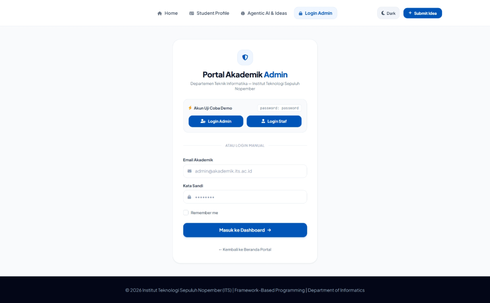
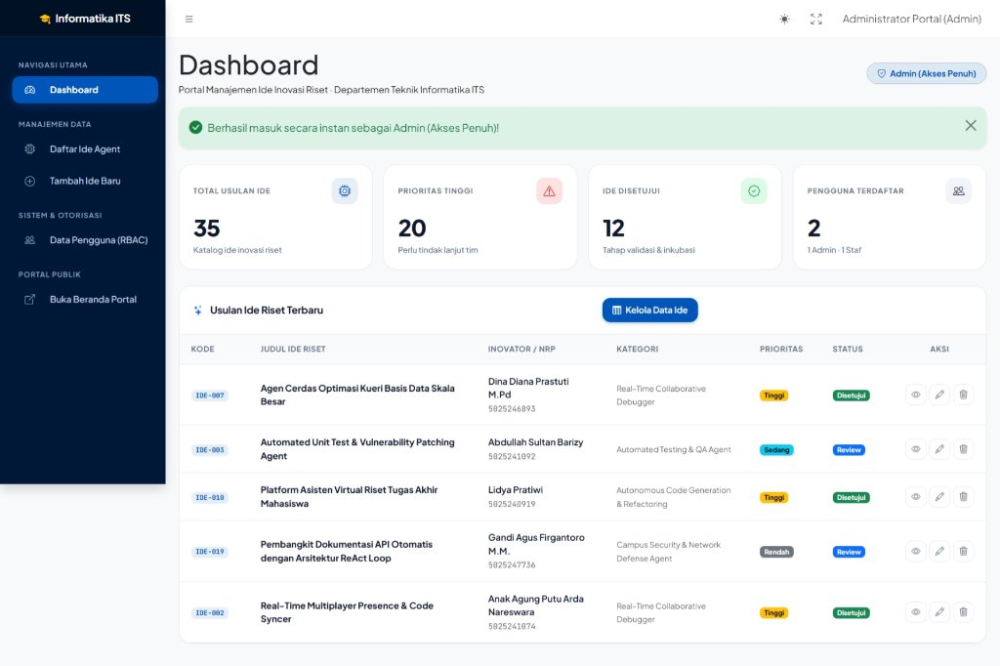
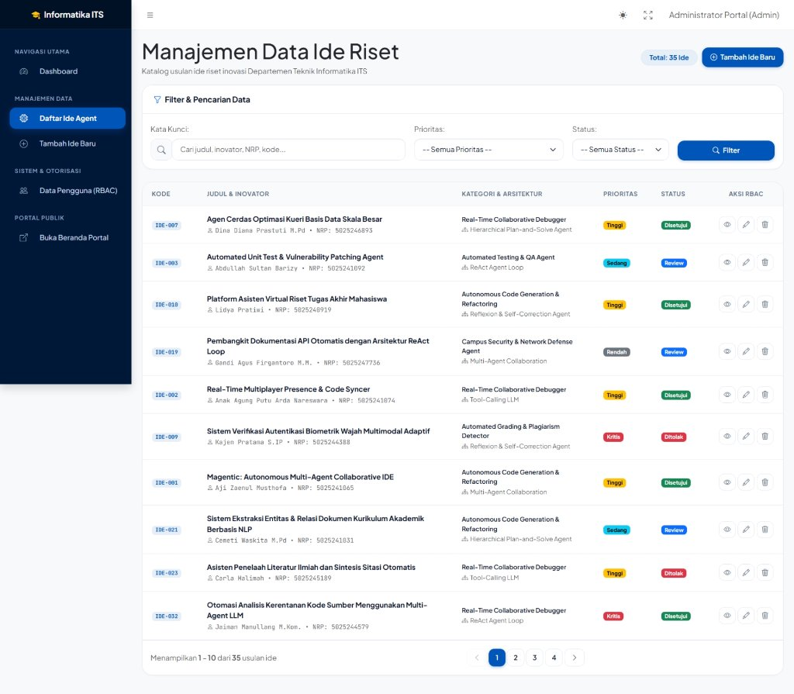

# Portal Akademik & Manajemen Ide Riset (Dashboard & RBAC)

Sistem informasi portal akademik dan manajemen katalog usulan ide riset *Agentic AI* Departemen Teknik Informatika ITS. Proyek ini mengintegrasikan portal publik, panel *backoffice* **AdminLTE 4**, autentikasi **Laravel Breeze**, serta otorisasi berbasis peran dinamis menggunakan **Spatie Laravel Permission**.

---

## Fitur Utama

1. **Panel Backoffice AdminLTE 4:**
   - Mewarisi master layout `@extends('adminlte::page')` dengan tema terintegrasi palet warna resmi Informatika ITS (*Deep Navy* `#001838` & *ITS Blue* `#0055B8`).
   - Dilengkapi *color mode* native (dukungan penuh *Light Mode* dan *Dark Mode* tanpa elemen bocor putih).
   - 4 Widget box statistik agregat dinamis (`AgentIdea::count()`, total prioritas tinggi/kritis, total usulan disetujui, dan total pengguna terdaftar).

2. **Role-Based Access Control (Spatie RBAC):**
   - **Admin (Akses Penuh):** Melihat dashboard, mengelola data ide riset (tambah, edit, dan **hak eksklusif hapus data**), serta mengelola matriks pengguna dan izin di menu *Data Pengguna (RBAC)*.
   - **Staf (Akses Terbatas):** Melihat dashboard, menginput ide baru, dan menyunting proposal. Tombol hapus disembunyikan dari antarmuka Blade dan dilindungi ganda pada level controller (*HTTP 403 Forbidden*).

3. **Pencarian Kondisional & Navigasi Bersih:**
   - Form pencarian data multi-parameter (kata kunci judul, inovator, NRP, kategori, tingkat prioritas, status) menggunakan kueri kondisional `when()`.
   - Pagination terkunci dengan method `withQueryString()` agar filter pencarian tidak hilang saat berpindah halaman data.
   - Komponen pagination kustom Bootstrap 5 dengan ikon panah chevron yang proporsional.

4. **Akun Uji Coba Demo (1-Click Auto-Login):**
   - Tombol instan pada halaman login untuk masuk sebagai Admin atau Staf tanpa perlu mengetik manual.

---

## Akun Uji Coba

Gunakan tombol **1-Click Login** pada halaman login (`/login`) atau masukkan kredensial berikut:

| Peran (Role) | Email | Password | Hak Akses |
| :--- | :--- | :--- | :--- |
| **Admin** | `admin@akademik.its.ac.id` | `password` | **Akses Penuh:** CRUD data ide, eksekusi hapus data, manajemen hak akses RBAC. |
| **Staf** | `staf@akademik.its.ac.id` | `password` | **Akses Terbatas:** Melihat data, menambah, menyunting. *(Tanpa hak hapus data & menu RBAC)* |

---

## Panduan Instalasi & Menjalankan

### Prasyarat:
- PHP >= 8.2
- Composer 2.x
- Node.js & NPM
- SQLite / MySQL

### Langkah Instalasi:

```bash
# 1. Clone repositori
git clone https://github.com/ajizaenulm/PBKK-Tugas-Week10.git
cd PBKK-Tugas-Week10

# 2. Salin environment file
cp .env.example .env
# Windows PowerShell: copy .env.example .env

# 3. Install dependensi backend & frontend
composer install
npm install

# 4. Generate application key
php artisan key:generate

# 5. Jalankan migrasi dan seeder data (Spatie roles + 35 ide riset otentik)
php artisan migrate --seed

# 6. Build aset frontend
npm run build

# 7. Jalankan server lokal
php artisan serve
```

Aplikasi dapat diakses melalui browser pada: **`http://localhost:8000`**

---

## Struktur Rute Aplikasi

### Halaman Publik
- `GET /` : Beranda portal akademik Informatika ITS
- `GET /profil-mahasiswa` : Halaman profil akademik mahasiswa
- `GET /ide-agent` : Formulir pengajuan dan eksplorasi ide riset inovasi AI

### Halaman Panel Backoffice (Wajib Login)
- `GET /login` : Halaman autentikasi dengan tombol *Quick Login*
- `GET /dashboard` : Beranda AdminLTE dengan 4 widget statistik agregat
- `GET /admin/ideas` : Katalog tabel data usulan ide riset (pencarian & filter)
- `GET /admin/ideas/create` : Formulir pendaftaran usulan ide baru
- `GET /admin/ideas/{id}` : Tampilan spesifikasi detail ide riset
- `GET /admin/ideas/{id}/edit` : Formulir perbaikan/penyuntingan data ide
- `DELETE /admin/ideas/{id}` : Hapus data fisik ide *(Eksklusif peran Admin)*
- `GET /admin/users` : Matriks hak akses Spatie RBAC *(Eksklusif peran Admin)*

---

## Tangkapan Layar (Screenshots)

### 1. Halaman Login & Quick Login Demo


### 2. Beranda Dashboard AdminLTE


### 3. Manajemen Data Ide Riset (Pencarian & Pagination)


### 4. Perbandingan Hak Akses (Admin vs Staf)
- **Tampilan Admin:** Menampilkan tombol hapus data (merah) dan menu navigasi *Data Pengguna (RBAC)*.
- **Tampilan Staf:** Tombol hapus data disembunyikan dari tabel Blade; percobaan request langsung via URL menghasilkan respon *403 Forbidden*.
